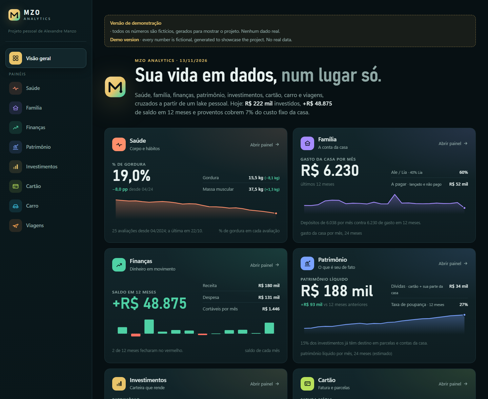
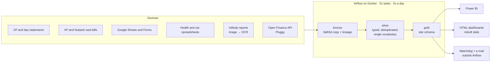
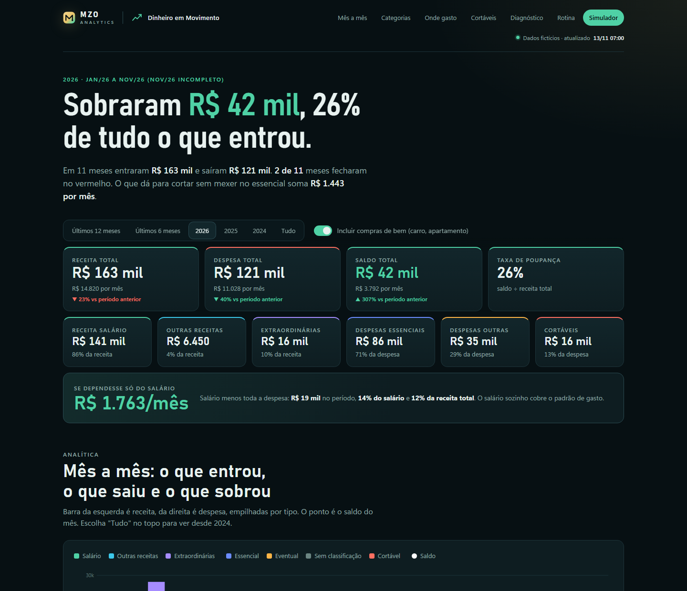
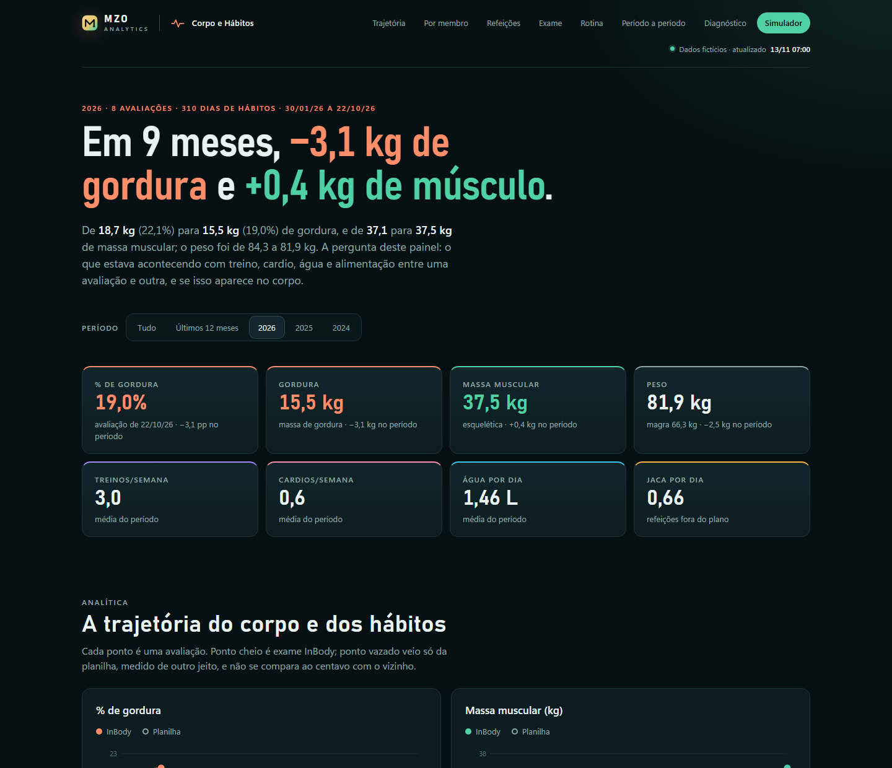
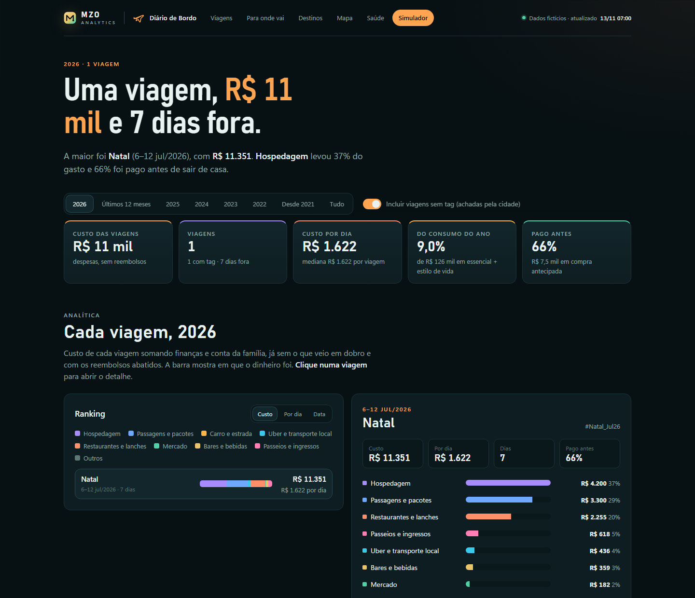
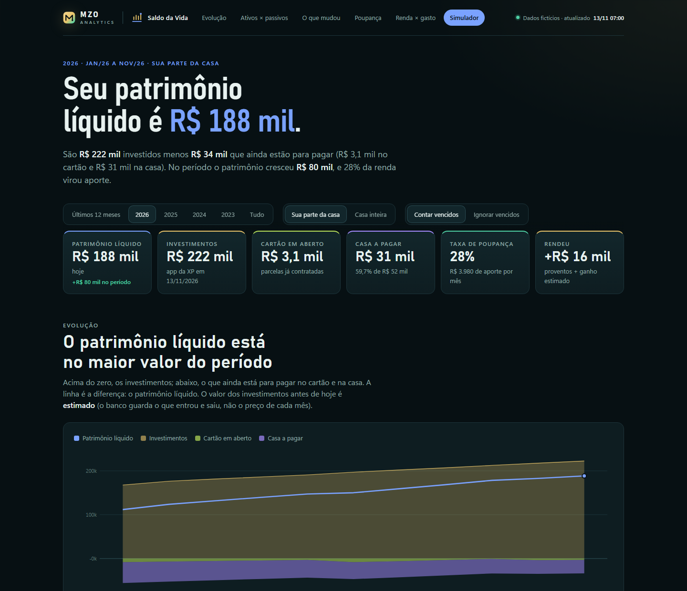

# Personal data platform

[Português](README.md) · **English**

A personal lakehouse on SQL Server, with a medallion architecture,
Airflow orchestration and analytical dashboards. Finances, investments,
health, daily routine, car and travel, handled with the rigor of a
corporate data project: lineage, idempotency, reconciliation, alerting,
and documentation that lives inside the database.

**[See the live demo →](https://alexandremanzo.github.io/plataforma-dados-pessoais/)**

> **Every number in the demo is fictitious.** The project runs for real
> on my own data; this public version swaps the data for a coherent
> synthetic generator. See [About the data](#about-the-data-all-fictitious).
> The dashboards and most of the documentation are in Portuguese.



---

## The problem

The data lived in hand-maintained spreadsheets read directly by Power
BI. Three weaknesses:

- **Manual consolidation.** Statements with overlapping date ranges were
  merged by eye, and knowing which rows already existed was nearly
  impossible.
- **No traceability.** A wrong number in a report could not be audited
  back to its source.
- **Raw data mixed with processed data.** Changing a classification rule
  meant rewriting the spreadsheet.

## The solution



| Layer | Role |
|---|---|
| `bronze` | Faithful copy of the source, all text. Each event once, with the file, sheet and row it came from. |
| `silver` | Typed, classified, standardized vocabulary. One table per business entity. |
| `gold` | Dimensional model (star schema). The only layer dashboards and Power BI read. |

### By the numbers

| | |
|---|---|
| Tables | **54** (13 bronze, 15 silver, 26 gold) + 4 views |
| Columns documented in the database | **720 of 720** |
| Load tasks in the DAG | **31**, in eleven independent branches |
| Scripts | 46 Python ETL, 52 SQL DDL, ~21k lines |
| Business facts | 8 (investments, positions, spending, household, day, habits, body, car) |
| Dashboards | 8 subjects in a single hub, rebuilt daily at 9am in the real project |

### Stack

Python (pandas, SQLAlchemy, pyodbc) · SQL Server 2022 · Apache Airflow ·
Docker · Power BI (version-controlled PBIP/TMDL) · Tesseract OCR ·
Open Finance API · dependency-free HTML/SVG · GitHub Actions

---

## Engineering decisions

**Every load is idempotent — and that is measured.** Re-running without
changing the source moves zero rows. Each run records inserted, updated
and `FL_CONVERGIU` (converged) in `gold.fato_carga`; a load that always
"moves" something is broken. That is how hundreds of phantom updates
and an oscillation between two pandas versions surfaced.

**Uniqueness is enforced by the database, not the script.** Each event
has a `hash_negocio` (SHA-256 of the normalized business key) with a
`UNIQUE` constraint. If the logic fails, the database rejects the
duplicate.

**Deduplication without a natural key.** Investment statements overlap.
The key uses the **running balance**: two real identical transactions
on the same day have different balances; a row entered twice repeats
the balance. Where there is no balance, an occurrence counter.

**A key that survives data corrections.** In hand-typed sources the
identity is an opaque ID of its own — so fixing a date, amount or
description arrives as an update, not as a new orphan row.

**Credit card double counting.** An expense exists both as a card
purchase and as the bill payment in the checking account. The fact has a
level (detail × summary), detected from the data itself, and the summary
level is used to **reconcile** bill paid × sum of items.

**Surrogate keys are never renumbered; a `-1` member in every
dimension.** Rule-derived attributes are updated, so improving a rule
reaches the entire history.

**Business rules as data.** Habit goals, which direction is better for
each body metric, how compressible each spending group is: all stored
in dimension columns. Changing your mind is an `UPDATE`, not a deploy.

**A long series is not a homogeneous series.** Body assessments span 18
years, but the device changed halfway. A flag marks the metrics that
cross both eras; two metrics with similar names are kept apart on
purpose — merged, they would show a 25 kg drop that never happened.

**OCR with cross-checks.** Bioimpedance reports arrive as images. The
reader crops each region, validates plausible ranges and checks
quantities against each other (fat ÷ weight vs. the % read); a reading
that does not add up does not get in.

**Documentation inside the database.** Every table and column has a
description as an *extended property*, exposed by
`gold.vw_glossario_dados`. The [glossary](docs/glossario.md) is
generated from it and travels with the backup.

**Monitoring that does not depend on what it monitors.** Task failures
send e-mail through Airflow; a **watchdog** runs from Windows Task
Scheduler, outside Docker, and warns if loads have stopped — even if the
database itself does not answer. The Open Finance consent expires after
12 months and then fails silently; the watchdog warns 60 days ahead.

More in [docs/en/architecture.md](docs/en/architecture.md) and
[docs/en/data-model.md](docs/en/data-model.md).

---

## The dashboards

Eight dashboards in a single hub, each with analytics, diagnostics and
a simulator. Hand-made HTML and SVG, no charting library, they open
offline.

| Dashboard | What it answers |
|---|---|
| Health | Body composition × habits between assessments, meals, per body segment, goal simulator |
| Shared household | Who contributed and who paid, split proportional to contributions, future commitments |
| Finances | Month by month, where to cut, spending calendar, routine × spending |
| Net worth | Net worth, savings rate, income × spending, projection |
| Investments | Portfolio, dividends, returns |
| Credit card | Bill × target, open installments, paid × billed reconciliation |
| Car | Cost per km, upcoming maintenance |
| Travel | Cost per trip and per day, map, travel × habits |

| | |
|---|---|
|  |  |
|  |  |

---

## Running the demo

Prerequisite: Docker. One command starts SQL Server, generates the
fictitious data and writes the dashboards to `site/`:

```bash
docker compose -f demo/docker-compose.yml up --build
```

Then open `site/index.html` in a browser. The same folder is published
to GitHub Pages by the [pages.yml](.github/workflows/pages.yml) workflow.

### Running the full pipeline

The real pipeline reads files and spreadsheets that are not part of this
repository. To set it up with your own sources: SQL Server with TCP/IP
enabled, Docker and Python 3.12+.

```powershell
copy .env.example .env              # credentials and paths
cd scripts\sql; .\executa.ps1       # creates the layers, in order
cd ..\..\airflow
copy .env.example .env
docker compose up -d                # Airflow at http://localhost:8080
```

To run the loads without Airflow, see [docs/operacao.md](docs/operacao.md)
(Portuguese).

---

## Layout

```
├── airflow/              Docker orchestration (DAG, Dockerfile, compose)
├── demo/                 fictitious data generator and demo database
├── docs/                 architecture, data model, operations, glossary
│   └── en/               English architecture and data model
├── powerbi/              PBIP/TMDL reports, generated by script
├── scripts/
│   ├── conf/             centralized connection
│   ├── etl/              bronze → silver → gold loads and business rules
│   ├── sql/              layer DDL, numbered in chronological order
│   ├── consultas/        sample analytical queries
│   └── paineis/          HTML dashboard generators
├── site/                 generated dashboards (GitHub Pages)
└── tools/                personal-data scan before publishing
```

Operations docs and how-to guides are in Portuguese only; the
[architecture](docs/en/architecture.md) and the
[data model](docs/en/data-model.md) are also in English.

---

## About the data: all fictitious

This repository is the showcase version of a project that runs on real
personal data. To publish it:

- **The data is synthetic.** The generator in `demo/` creates years of
  transactions, card bills, investments, habits and assessments with
  realistic patterns (seasonality, installments, trips, routine effects),
  but no value is real.
- **Names of people, places, merchants and amounts were replaced** in
  the code and documentation. Where the text quotes a number to explain
  a decision, it is illustrative.
- **There is a scan before every publish.**
  [`tools/varredura_pii.py`](tools/varredura_pii.py) looks for Brazilian
  tax IDs (CPF/CNPJ), e-mails, phone numbers, local paths and secrets
  (also in CI) and, on the author's machine, a private list of terms
  generated from the real database — the list itself is not versioned.
- **Left out:** third-party sources (condominium) and one dashboard of a
  personal nature.

---

## How it was built

A personal project, designed and maintained by me. I use **Claude Code**
as a day-to-day productivity tool — to speed up implementation, review
and documentation — while the architecture, modeling and business-rule
decisions are made and validated by me, against the data.

## Author

**Alexandre Manzo** — Data / BI Analyst, 15+ years in dimensional
modeling, ETL and visualization.
[LinkedIn](https://www.linkedin.com/in/alexandremanzo/)

[MIT](LICENSE) license.
