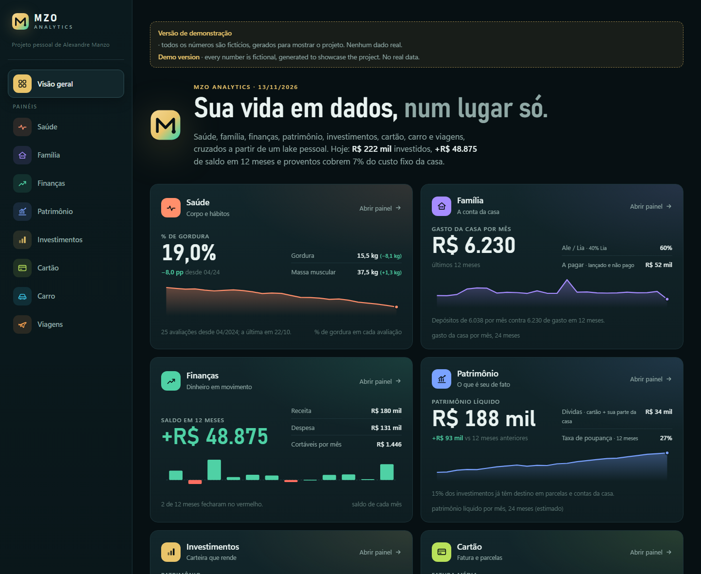
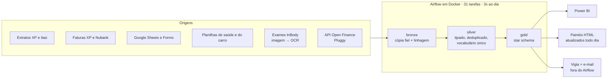
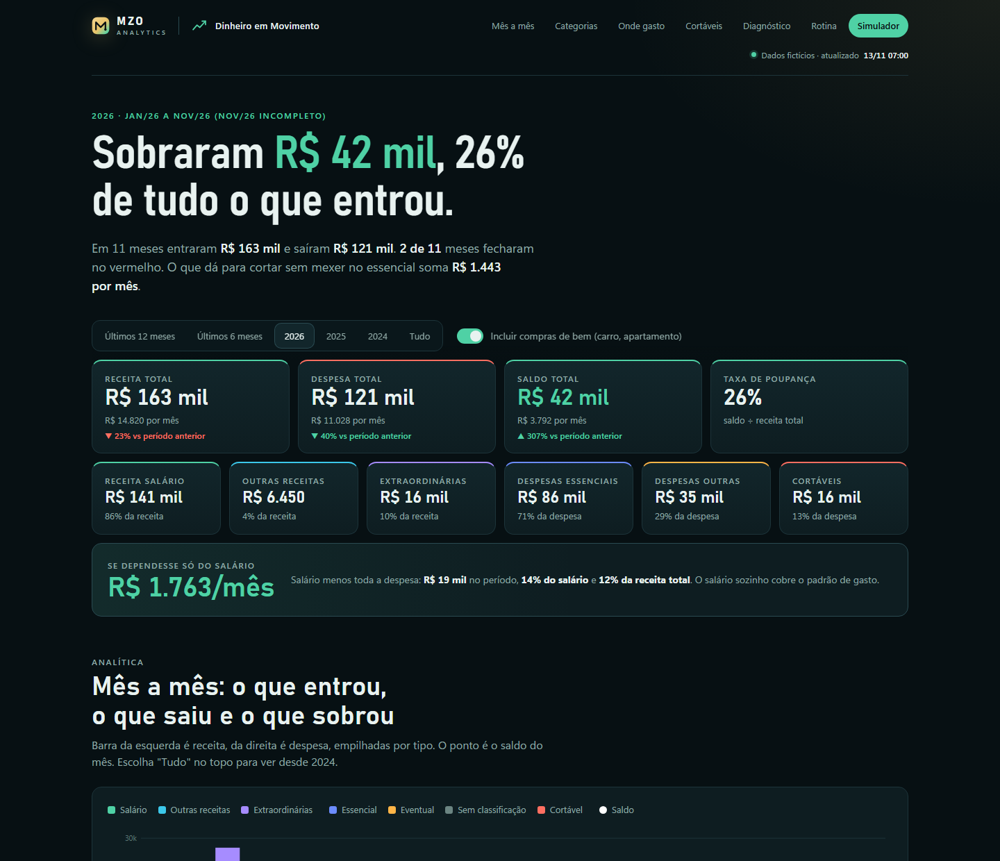
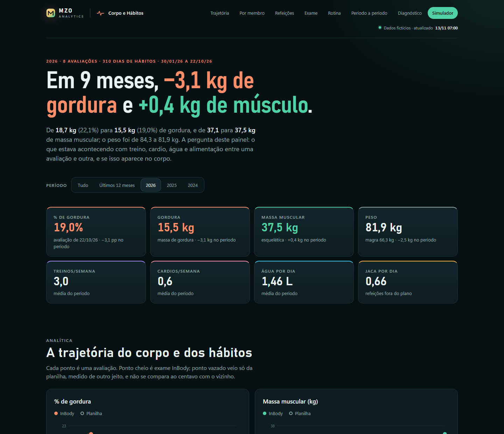
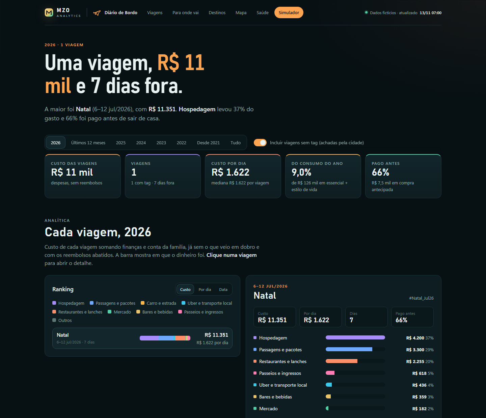
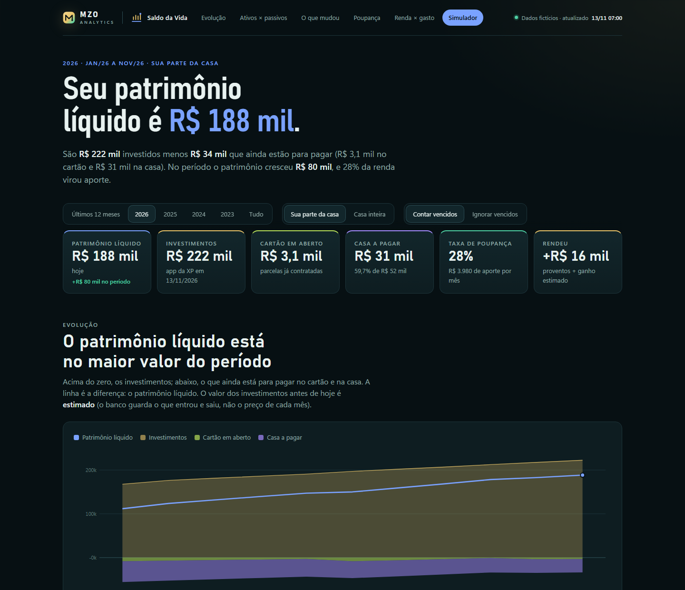

# Plataforma de dados pessoais

**Português** · [English](README.en.md)

Um lakehouse pessoal em SQL Server, com arquitetura medalhão, orquestração
em Airflow e painéis analíticos. Finanças, investimentos, saúde, rotina,
carro e viagens tratados com o rigor de um projeto de dados corporativo:
linhagem, idempotência, conciliação, alertas e documentação que mora
dentro do banco.

**[Ver a demo ao vivo →](https://alexandremanzo.github.io/plataforma-dados-pessoais/)**

> **Todos os números da demo são fictícios.** O projeto roda de verdade
> sobre os meus dados; esta versão pública troca os dados por um gerador
> sintético e coerente. Ver [Sobre os dados](#sobre-os-dados-tudo-fictício).



---

## O problema

Os dados viviam em planilhas alimentadas à mão e lidas direto pelo
Power BI. Três fragilidades:

- **Consolidação manual.** Extratos com janelas sobrepostas eram juntados
  "no olho", e saber quais linhas já existiam era praticamente impossível.
- **Sem rastreabilidade.** Um número errado no relatório não tinha como
  ser auditado até a origem.
- **Dado bruto misturado com dado tratado.** Mudar uma regra de
  classificação significava reescrever a planilha.

## A solução



| Camada | Papel |
|---|---|
| `bronze` | Cópia fiel da origem, tudo em texto. Cada evento uma vez, com o arquivo, a aba e a linha de onde veio. |
| `silver` | Tipada, classificada, com vocabulário padronizado. Uma tabela por entidade de negócio. |
| `gold` | Modelo dimensional (star schema). A única camada que os painéis e o Power BI leem. |

### Em números

| | |
|---|---|
| Tabelas | **54** (13 bronze, 15 silver, 26 gold) + 4 views |
| Colunas documentadas no banco | **720 de 720** |
| Tarefas de carga na DAG | **31**, em onze ramos independentes |
| Scripts | 46 de ETL em Python, 52 de DDL em SQL, ~21 mil linhas |
| Fatos de negócio | 8 (investimentos, posição, gastos, família, dia, hábitos, corpo, carro) |
| Painéis | 8 temas num hub único, regerados todo dia às 9h no projeto real |

### Stack

Python (pandas, SQLAlchemy, pyodbc) · SQL Server 2022 · Apache Airflow ·
Docker · Power BI (PBIP/TMDL versionado) · Tesseract OCR · API Open Finance ·
HTML/SVG sem dependências · GitHub Actions

---

## Decisões de engenharia

**Toda carga é idempotente — e isso é medido.** Rodar de novo sem mudar a
origem move zero linhas. Cada execução grava inseridos, atualizados e
`FL_CONVERGIU` em `gold.fato_carga`; carga que "mexe" sempre está com
defeito. Foi assim que apareceram centenas de atualizações fantasma e uma
oscilação entre duas versões do pandas.

**A unicidade é imposta pelo banco, não pelo script.** Cada evento tem um
`hash_negocio` (SHA-256 da chave de negócio normalizada) com constraint
`UNIQUE`. Se a lógica falhar, o banco recusa a duplicata.

**Deduplicação sem chave natural.** Extratos de investimento se
sobrepõem. A chave usa o **saldo corrente**: duas transações reais
idênticas no mesmo dia têm saldos diferentes; uma linha lançada em
duplicidade repete o saldo. Onde não há saldo, um contador de ocorrência.

**Chave que sobrevive à correção do dado.** Nas bases digitadas à mão, a
identidade é um ID próprio, sem significado — então corrigir data, valor
ou descrição chega como atualização, e não como linha nova órfã.

**Dupla contagem de cartão.** Um gasto existe como compra no cartão e
como pagamento da fatura na conta. O fato tem um nível (analítico ×
sintético), detectado a partir dos próprios dados, e o sintético serve
para **conciliar** fatura paga × soma dos itens.

**Chaves substitutas nunca renumeradas; membro `-1` em toda dimensão.**
Atributos derivados de regra são atualizados, então melhorar uma regra
alcança o histórico inteiro.

**Regra de negócio como dado.** Meta de hábito, sentido em que cada
medida corporal melhora, compressibilidade de cada grupo de gasto: tudo
em colunas das dimensões. Mudar de ideia é um `UPDATE`, não um deploy.

**Série longa não é série homogênea.** A avaliação física cobre 18 anos,
mas o aparelho mudou no meio. Uma flag marca as métricas que atravessam
as duas eras; duas métricas de nome parecido ficam separadas de
propósito — unidas, mostrariam uma queda de 25 kg que nunca aconteceu.

**OCR com conferência.** Os laudos de bioimpedância chegam como imagem.
A leitura recorta cada região, valida faixas plausíveis e confere
grandezas entre si (gordura ÷ peso contra o % lido); leitura que não
fecha não entra.

**Documentação dentro do banco.** Toda tabela e coluna tem descrição como
*extended property*, exposta por `gold.vw_glossario_dados`. O
[glossário](docs/glossario.md) é gerado dali e viaja com o backup.

**Observabilidade que não depende do que observa.** Falha de tarefa
dispara e-mail pelo Airflow; um **vigia** roda pelo Agendador do Windows,
fora do Docker, e avisa se as cargas pararam — inclusive se o próprio
banco não responder. O consentimento do Open Finance vence em 12 meses
e para em silêncio; o vigia avisa 60 dias antes.

Mais em [docs/arquitetura.md](docs/arquitetura.md) e
[docs/modelo-dados.md](docs/modelo-dados.md).

---

## Os painéis

Oito painéis num hub único, cada um com analítica, diagnóstico e
simulador. HTML e SVG feitos à mão, sem biblioteca de gráficos, abrem
offline.

| Painel | O que responde |
|---|---|
| Saúde | Composição corporal × hábitos entre avaliações, refeições, por membro do corpo, simulador de metas |
| Casa compartilhada | Quem aportou e quem pagou, divisão proporcional aos aportes, compromissos futuros |
| Finanças | Mês a mês, onde cortar, calendário de gastos, rotina × gasto |
| Patrimônio | Patrimônio líquido, taxa de poupança, renda × gasto, projeção |
| Investimentos | Carteira, proventos, resultado |
| Cartão | Fatura × meta, parcelas em aberto, conciliação pago × fatura |
| Carro | Custo por km, manutenção prevista |
| Viagens | Custo por viagem e por dia, mapa, viagem × hábitos |

| | |
|---|---|
|  |  |
|  |  |

---

## Rodar a demo

Pré-requisito: Docker. Um comando sobe o SQL Server, gera os dados
fictícios e escreve os painéis em `site/`:

```bash
docker compose -f demo/docker-compose.yml up --build
```

Depois é só abrir `site/index.html` no navegador. A mesma pasta é
publicada no GitHub Pages pelo workflow [pages.yml](.github/workflows/pages.yml).

### Rodar o pipeline completo

O pipeline real lê arquivos e planilhas que não fazem parte deste
repositório. Para montá-lo com as suas próprias origens: SQL Server com
TCP/IP habilitado, Docker e Python 3.12+.

```powershell
copy .env.example .env              # credenciais e caminhos
cd scripts\sql; .\executa.ps1       # cria as camadas, em ordem
cd ..\..\airflow
copy .env.example .env
docker compose up -d                # Airflow em http://localhost:8080
```

Para rodar as cargas sem o Airflow, veja [docs/operacao.md](docs/operacao.md).

---

## Estrutura

```
├── airflow/              orquestração em Docker (DAG, Dockerfile, compose)
├── demo/                 gerador de dados fictícios e banco da demo
├── docs/                 arquitetura, modelo de dados, operação, glossário
│   └── en/               tradução da arquitetura e do modelo de dados
├── powerbi/              relatórios em PBIP/TMDL, gerados por script
├── scripts/
│   ├── conf/             conexão centralizada
│   ├── etl/              cargas bronze → silver → gold e regras de negócio
│   ├── sql/              DDL das camadas, numerado em ordem cronológica
│   ├── consultas/        consultas analíticas de exemplo
│   └── paineis/          geradores dos painéis HTML
├── site/                 painéis gerados (GitHub Pages)
└── tools/                varredura de dados pessoais antes de publicar
```

A documentação de operação e os roteiros práticos estão só em português;
a [arquitetura](docs/en/architecture.md) e o
[modelo de dados](docs/en/data-model.md) também em inglês.

---

## Sobre os dados: tudo fictício

Este repositório é a versão de apresentação de um projeto que roda sobre
dados pessoais reais. Para publicá-lo:

- **Os dados são sintéticos.** O gerador em `demo/` cria anos de
  lançamentos, faturas, investimentos, hábitos e avaliações com padrões
  verossímeis (sazonalidade, parcelas, viagens, efeito da rotina), mas
  nenhum valor é real.
- **Nomes de pessoas, lugares, estabelecimentos e valores foram
  trocados** no código e na documentação. Onde o texto cita um número para
  explicar uma decisão, ele é ilustrativo.
- **Há uma varredura antes de cada publicação.**
  [`tools/varredura_pii.py`](tools/varredura_pii.py) procura CPF, CNPJ,
  e-mail, telefone, caminhos locais e segredos (também no CI) e, na
  máquina do autor, uma lista privada de termos gerada a partir do banco
  real — a lista não é versionada.
- **Ficaram de fora** as origens de terceiros (condomínio) e um painel de
  cunho pessoal.

---

## Como foi construído

Projeto pessoal, desenhado e mantido por mim. Uso o **Claude Code** como
ferramenta de produtividade no dia a dia — para acelerar implementação,
revisão e documentação — com as decisões de arquitetura, modelagem e
regras de negócio tomadas e validadas por mim, contra os dados.

## Autor

**Alexandre Manzo** — Analista de Dados / BI, 15+ anos com modelagem
dimensional, ETL e visualização.
[LinkedIn](https://www.linkedin.com/in/alexandremanzo/)

Licença [MIT](LICENSE).
