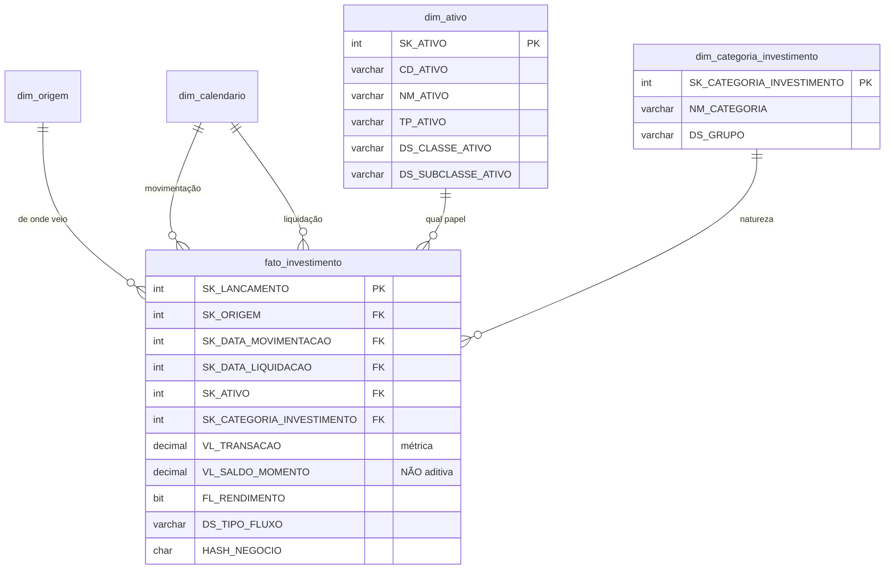
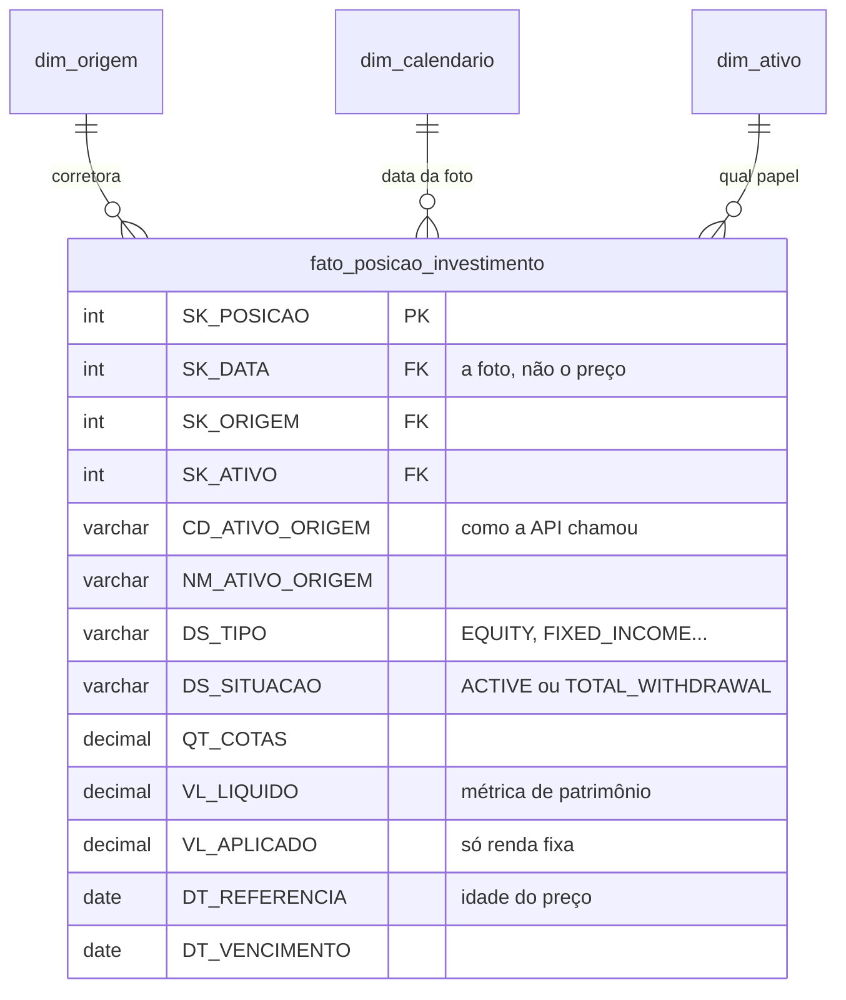
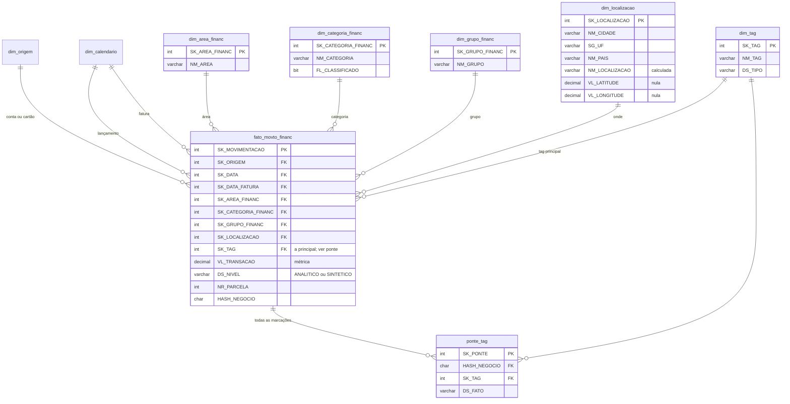
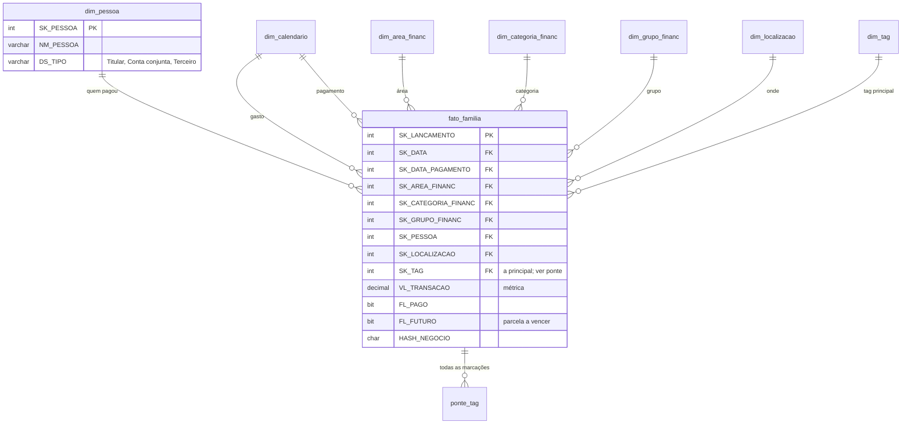
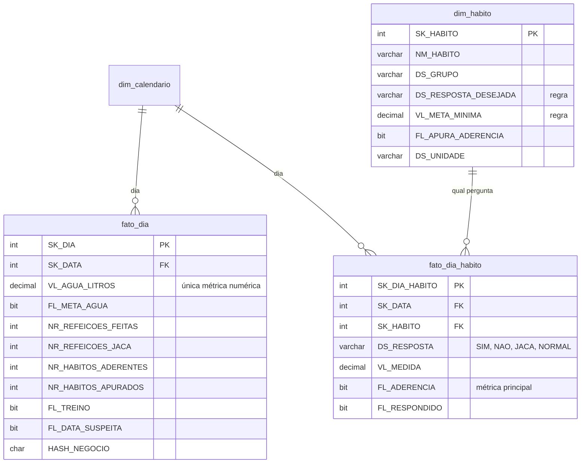
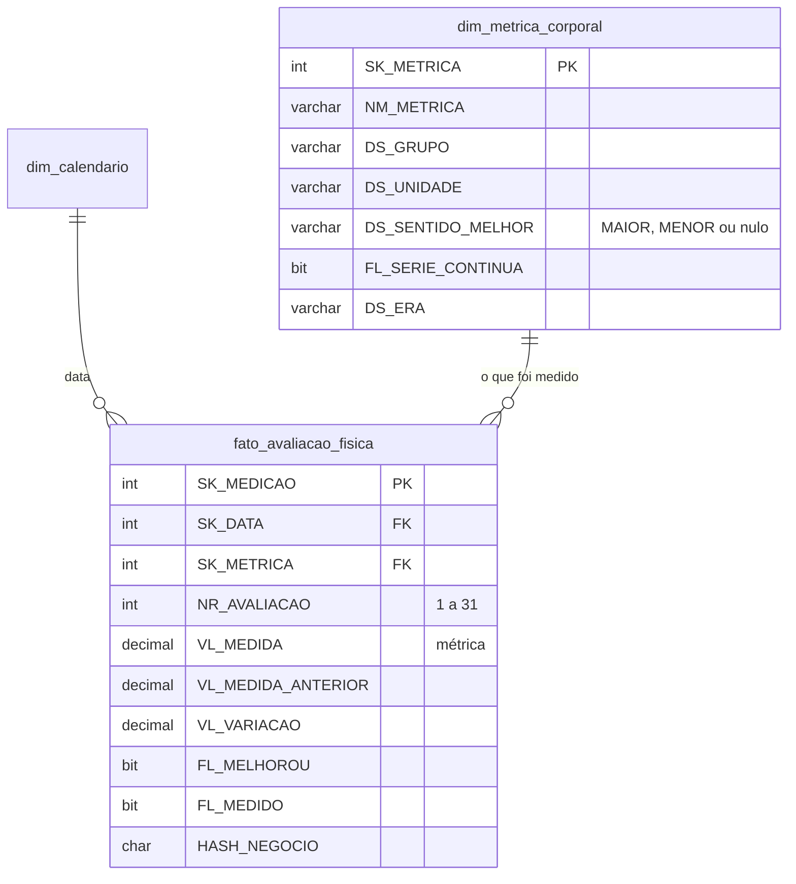
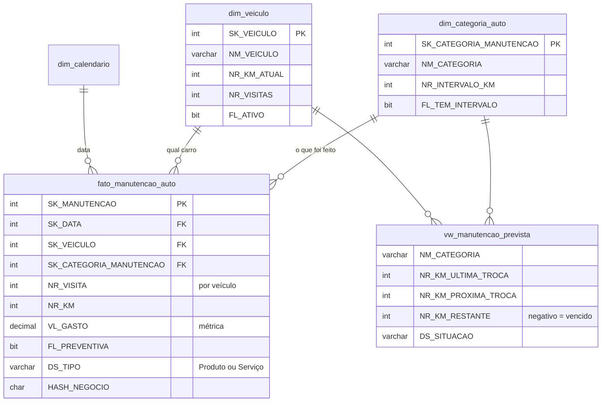
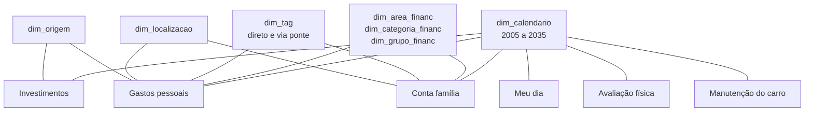
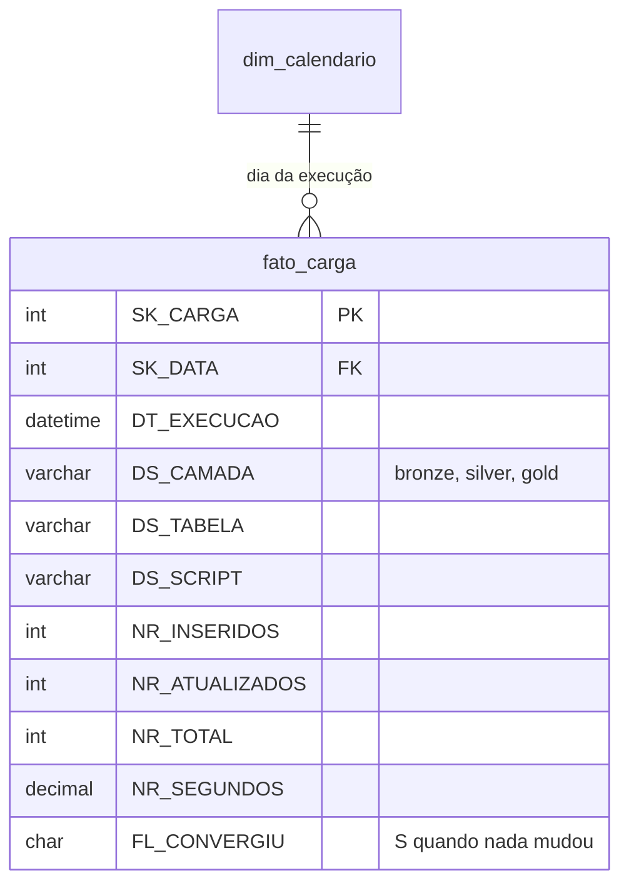

# Data model — gold layer

> English translation of [modelo-dados.md](../modelo-dados.md). The ER
> diagrams are the same; the generated SQL query for each fact (every
> dimension already joined) lives in the Portuguese document. Table and
> column names stay in Portuguese, as they are in the database.

Six subjects, six independent models. Each answers its own question and
can be read on its own.

**What separates them** is deliberate: they are different kinds of
money and different natures, and adding across them produces numbers
without meaning. **What connects them** is the calendar — enough to
cross spending, habits and body measurements by date.

## Conventions

| Symbol | Meaning |
|---|---|
| `fato_*` | Fact table — the events, with their metrics |
| `dim_*` | Dimension — the axes used to filter and group |
| `ponte_*` | Bridge table — resolves a many-to-many relationship |
| `vw_*` | View — derived calculation, always current |
| `SK_` | Surrogate key. `-1` is always the "not informed" member |
| `HASH_NEGOCIO` | Event identity, with `UNIQUE`. It is what prevents duplicates |

Every dimension has the `-1` member, so **no fact is left without an
axis** — a transaction with no category points to "A classificar" (to
classify), not to null.

---

## 1. Investments

**Grain:** one investment account transaction.

**Two dates, two meanings.** The movement date is when the order
happened; the settlement date is when the money changed hands. Both
point to the same calendar.

> **`VL_SALDO_MOMENTO` is not additive.** It is the cash balance at the
> moment of the transaction, not net worth. Summing it means nothing.
>
> **Transactions without an asset** (transfers, withdrawals, income
> tax) point to "Não aplicável" (not applicable), and that is correct.

### 1b. Portfolio position

**Grain:** one asset on one snapshot date.

**It complements the fact above; it does not replace it.** That one
stores **flow** — dividend, tax, fee, trade — and answers *how much
moved*. This one stores **position** and answers *how much is held*.
Different question, different grain, different fact.

**The source is the Pluggy API (Open Finance), not the statement.**
They are complementary: the API provides per-asset trades and reaches
back 12 months; the statement provides the account cash flow since
2021.

> **Two dates, and mixing them splits the snapshot.** `SK_DATA` is when
> Pluggy refreshed the connection — the same for the whole read, and
> **it is the one to sum net worth by**. `DT_REFERENCIA` is that asset's
> own price date: a single snapshot brought three different dates, and
> summing by it spreads the same wealth over three days.
>
> **Closed positions stay**, with `DS_SITUACAO = 'TOTAL_WITHDRAWAL'`
> and zero balance. For the live portfolio, filter `ACTIVE`.
>
> **The Open Finance consent expires** and, when it does, the API does
> not fail: it keeps answering with stale data. The expiry date is
> stored and the watchdog warns 60 days ahead.

---

## 2. Personal spending

**Grain:** one checking-account or credit-card transaction.

> **Tags: two doors, and they do not give the same number.** `SK_TAG`
> stores **one** tag per transaction — the main one, chosen by
> `gold.vw_tag_principal` (Trip beats Property, which beats Marker).
> It is the everyday door: slicing with no bidirectional relationship
> and no duplicated rows. `ponte_tag` stores **all** of them.
>
> For **totals by tag, use the bridge**. Summing by `SK_TAG`
> undercounts the tags that lost the tie-break; the
> `46_fato_sk_tag.sql` script prints that difference every time it runs.

> **`dim_localizacao` does not fix spelling.** The same city shows up
> under different states in a handful of transactions, and each
> combination is a separate member. **When filling latitude and
> longitude**, those cities have more than one row and must receive the
> same coordinates — `45_dim_localizacao.sql` lists them on every run.

> **When summing expenses, filter `DS_NIVEL = 'ANALITICO'`.** A card
> expense exists on two planes — the detailed purchase and the bill
> payment in the checking account. Adding both counts the same expense
> twice.
>
> **Transfers between own accounts** are real movement but not
> spending. The expense measure must exclude the `TRANSFERENCIA` area.
>
> **A share of the detail transactions is still "A classificar"** —
> the classification backlog is visible, not hidden.

---

## 3. Household account

**Grain:** one shared expense of the couple.

**A fact separate from personal spending, on purpose.** This money
comes from the monthly contributions of both partners to the joint
accounts. Mixing it with `fato_movto_financ` would count two people's
spending as one person's.

**But it shares the three classification dimensions** with the personal
fact, which is what allows comparing "how much I spent on food on my
own" with "how much the household spent on food" along the same axis.

> **`FL_FUTURO` separates what happened from what is committed.** There
> are installments due years ahead; summing both together mixes past
> and commitment.

---

## 4. My day (habits journal)

**Grain:** one day — and, in the long fact, one day per habit.

**Two facts from the same source, on purpose.** The wide one crosses
habits with each other and sums liters of water; the long one makes the
adherence panel a single chart with a single measure — and a new
question in the form comes in without rebuilding the report.

**The adherence rule is data, not code.** `DS_RESPOSTA_DESEJADA` and
`VL_META_MINIMA` live in the dimension; the load only applies them.
Changing the water goal is an `UPDATE` followed by a new load.

> **Never add the two facts together** — they are the same information
> in two shapes.
>
> **Use `AVG(FL_ADERENCIA)`, not `SUM`.** The average naturally ignores
> context habits, which have no defined goal.

---

## 5. Body assessment

**Grain:** one assessment per measured metric.

**The longest series in the project:** assessments from 2008 to 2026.

**The change lives in the fact** because assessments are irregular —
from 21 days to almost five years apart. "Previous" matches no calendar
period, and computing the comparison in DAX would be expensive and
fragile.

> **Filter `FL_SERIE_CONTINUA = 1`** on the long-term chart. Only five
> metrics cross both measurement eras; the others produce lines that
> start or stop in the middle.
>
> **`Massa Muscular` is not `Massa Muscular/Ossea`.** Combined, they
> show a 25 kg drop that never happened.
>
> **`VL_MEDIDA` mixes units** — kg, cm, %, liters, points. Every
> aggregation needs a filter by metric.

---

## 6. Car maintenance

**Grain:** one item of each workshop visit.

**The only view in the model.** `vw_manutencao_prevista` crosses the
last replacement of each category with the recommended interval and the
current mileage — that is what turns history into prediction. It is a
view and not a table because the result depends on the current mileage,
and materializing it would invite reading a stale number.

> **Mileage is not comparable across vehicles.** Each has its own
> odometer, and the newer car has the lower number.
>
> **Everything shows as "up to date" right after a service**, by
> construction: the current mileage comes from the last workshop visit.

---

## What connects the six

| Dimension | Shared by | What it enables |
|---|---|---|
| `dim_calendario` | all six subjects | Crossing spending, habits and body measurements by date |
| `dim_area_financ`, `dim_categoria_financ`, `dim_grupo_financ` | personal spending, household | Comparing own and household spending along the same axis |
| `dim_tag` | personal spending, household | Adding up "how much the trip cost" across sources |
| `dim_localizacao` | personal spending, household | Spending by city, with a place ready to receive coordinates |
| `dim_origem` | personal spending, investments | Separating account, card and broker |

**The calendar runs from 2005 to 2035**, and the range is fixed on
purpose. It must cover the oldest source — body assessments start in
2008 — and the furthest commitment — household installments years
ahead. A range computed from the current year would eventually break
the load on a foreign key, all by itself.

### Two month formats, each with a role

| Column | Example | Used for |
|---|---|---|
| `NM_ANO_MES` | `2026-01` | **Sorting and comparing.** Sorts correctly as text |
| `NM_MES_ANO` | `Jan/2026` | **Display.** Axis and filter label |

Sorting by `NM_MES_ANO` puts April before January, and the mistake does
not look like an error — it looks like a chart with shuffled months.

### Holidays

`FL_FERIADO` (`S`/`N`), `NM_FERIADO` and `DS_TIPO_FERIADO` cover
**national** holidays: the nine fixed ones — Black Consciousness Day
only from 2024, when it became national — plus Good Friday as
`Nacional`, and Carnival (Monday, Tuesday and Ash Wednesday) and Corpus
Christi as `Facultativo` (optional).

`FL_FERIADO = 'S'` covers both types on purpose: to explain spending
and routine, what matters is whether shops were open. On holidays the
average daily spending is about half of a regular day.

Easter is computed, not typed year by year, and the script checks the
result against four years of known dates before writing — getting
Easter wrong would shift Carnival and Corpus Christi as a block, and a
holiday on the wrong Tuesday catches nobody's attention.

> **State and municipal holidays were not included.** Adding them
> gives 21/04 two names, and `NM_FERIADO` holds only one — so the
> script aborts instead of choosing by itself.

---

## Connecting it in Power BI

Everything is a direct dimension-to-fact relationship, including
`dim_tag` (by `SK_TAG`) and `dim_localizacao` (by `SK_LOCALIZACAO`).
**Start there** — it needs no configuration and does not duplicate
rows.

The bridge only comes in when the question is *total by tag*, and then
it needs care:

1. `dim_tag` → `ponte_tag` by `SK_TAG`
2. `ponte_tag` → the fact by `HASH_NEGOCIO`, with **cross-filtering in
   both directions** — without it the filter never reaches the fact

> A transaction with two tags shows up twice when crossing through the
> bridge. Summing amounts without filtering one specific tag double
> counts.

---

## The fact that watches the others

`gold.fato_carga` is not a business fact: it records **every run of
every load** — inserted, updated, total, and whether it converged. It
is the raw material for the load report and for the watchdog that warns
when a table stops loading.

> **`FL_CONVERGIU = 'S'` is the project's contract:** running again,
> without touching the source, moves zero rows. A load that always
> moves something is not tracking change — it is broken. That is how
> hundreds of phantom updates in the financial history surfaced, along
> with an oscillation between two pandas versions.

---

## About the queries

The SQL blocks under each model in the Portuguese document **are
generated**, not hand-written, by
`scripts/etl/exporta_consultas_modelo.py`. The joins come from
`sys.foreign_keys` — the only place where they cannot be out of date,
because the database itself enforces them. A hand-written query only
holds while it lists every dimension of the fact, and it ages silently
at the first new key: it keeps running and returning numbers.

The description of every table and column is in the
[glossary](../glossario.md) (Portuguese), generated from the database
itself.
