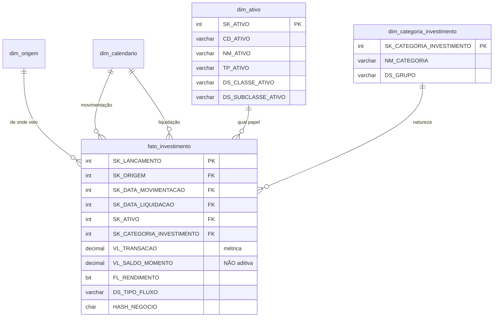
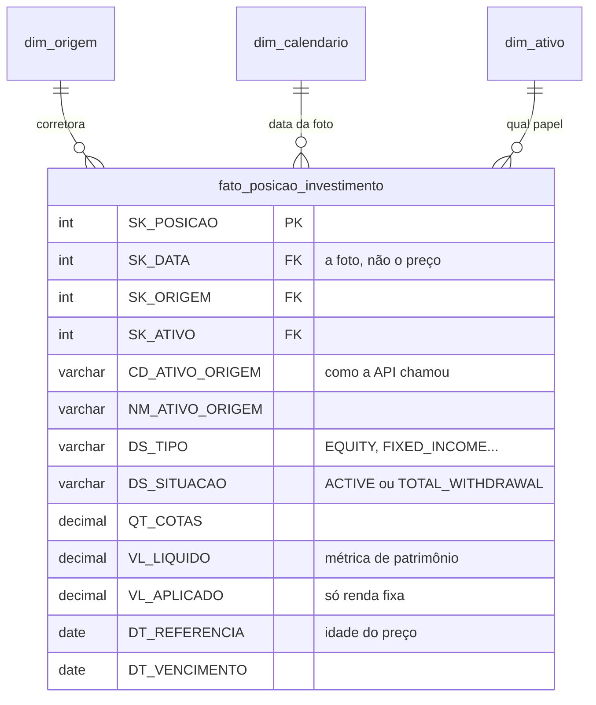
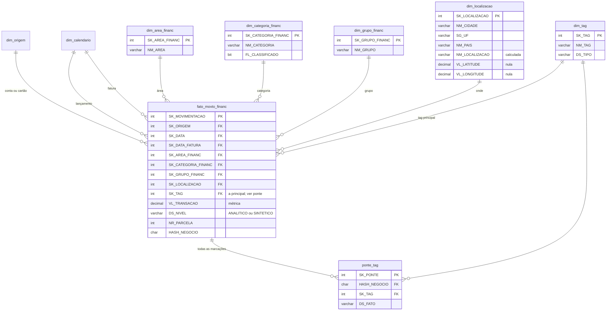
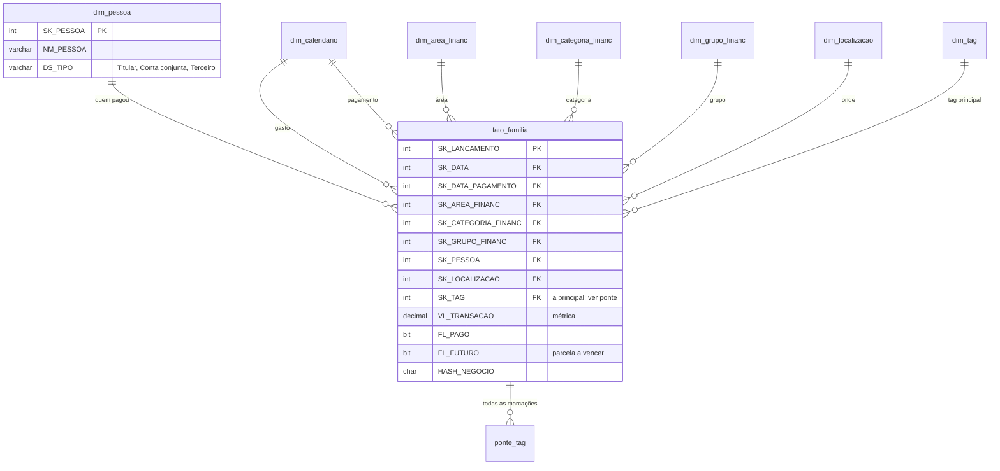
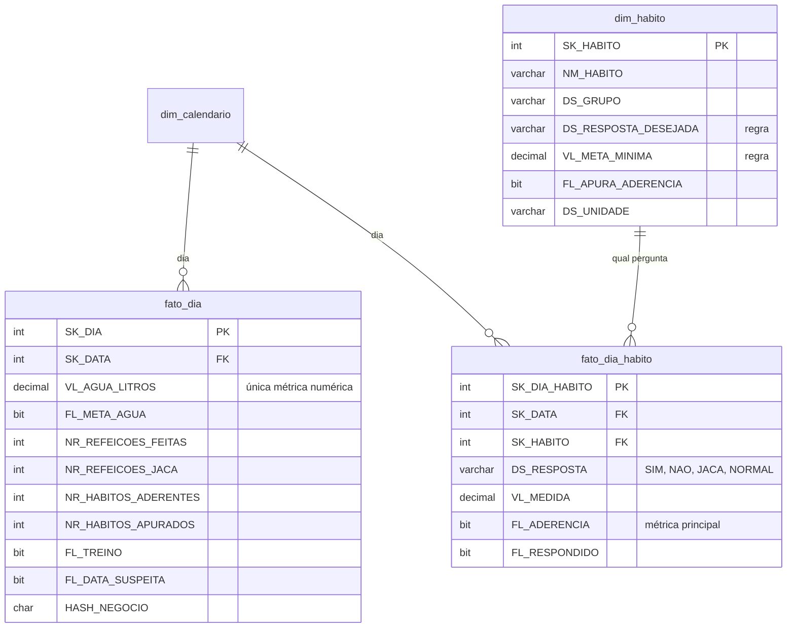
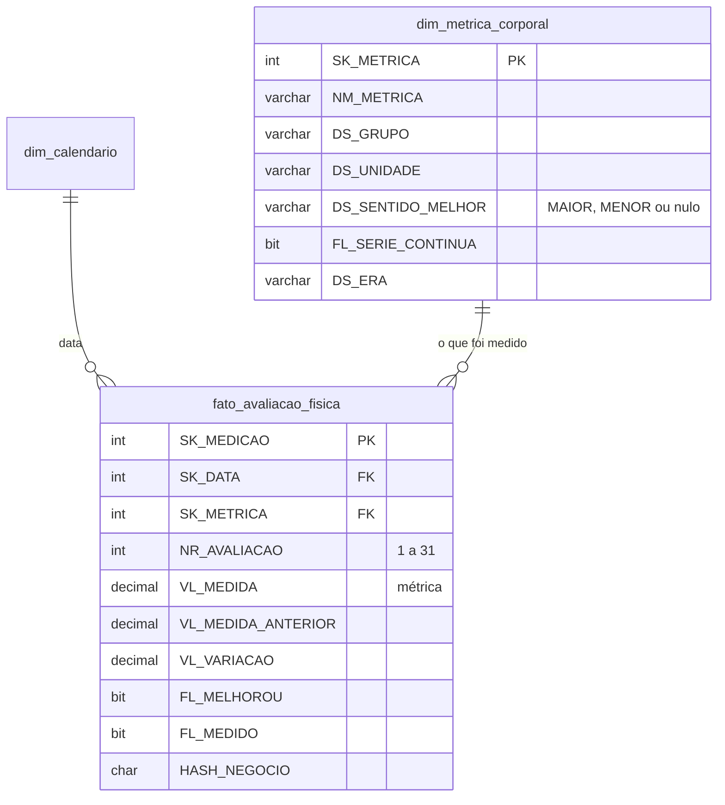
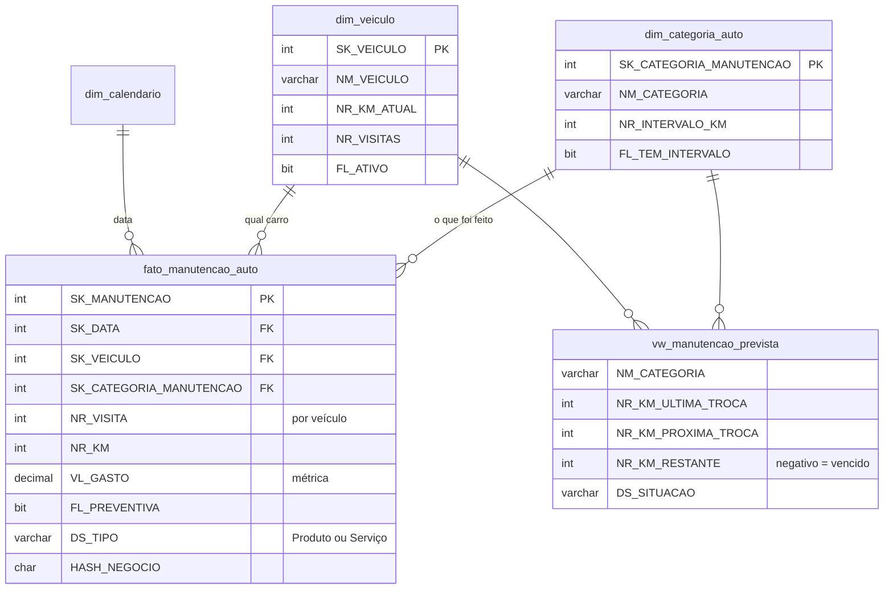
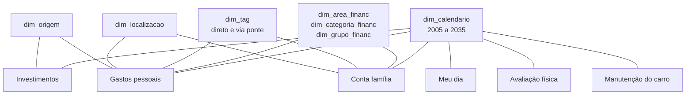
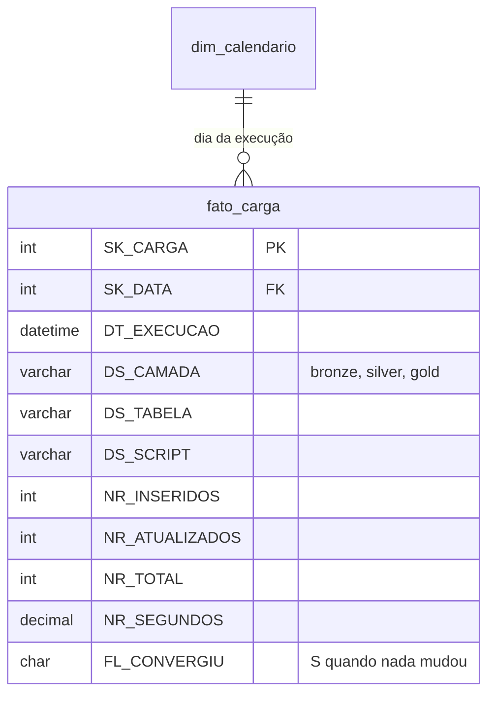

# Modelo de dados — camada gold

Seis assuntos, seis modelos independentes. Cada um responde a uma
pergunta própria e pode ser lido sozinho.

**O que os separa** é deliberado: são dinheiros e naturezas diferentes,
e somar entre eles produz número sem significado. **O que os liga** é o
calendário — e é o bastante para cruzar gasto, hábito e medida corporal
pela mesma data.

## Convenção

| Símbolo | Significa |
|---|---|
| `fato_*` | Tabela de fatos — os eventos, com as métricas |
| `dim_*` | Dimensão — os eixos pelos quais se filtra e agrupa |
| `ponte_*` | Tabela ponte — resolve relação muitos-para-muitos |
| `vw_*` | View — cálculo derivado, sempre atual |
| `SK_` | Chave substituta. `-1` é sempre o membro "não informado" |
| `HASH_NEGOCIO` | Identidade do evento, com `UNIQUE`. É o que impede duplicata |

Toda dimensão tem o membro `-1`, então **nenhum fato fica sem eixo** —
um lançamento sem categoria aponta para "A classificar", não para nulo.

---

## 1. Investimentos

**Grão:** um lançamento da conta de investimento.



<!-- consulta:fato_investimento -->
```sql
SELECT
    f.VL_TRANSACAO,
    f.VL_SALDO_MOMENTO,
    f.DS_TIPO_FLUXO,
    f.DS_DETALHE_ORIGINAL,
    f.FL_RENDIMENTO,
    ativo.CD_ATIVO                     AS ativo_cd_ativo,
    ativo.NM_ATIVO                     AS ativo_nm_ativo,
    categoria_investimento.NM_CATEGORIA AS categoria_investimento_nm_categoria,
    categoria_investimento.DS_GRUPO    AS categoria_investimento_ds_grupo,
    data_liquidacao.DT_DATA            AS data_liquidacao_dt_data,
    data_liquidacao.NM_MES             AS data_liquidacao_nm_mes,
    data_movimentacao.DT_DATA          AS data_movimentacao_dt_data,
    data_movimentacao.NM_MES           AS data_movimentacao_nm_mes,
    origem.CD_ORIGEM                   AS origem_cd_origem,
    origem.NM_ORIGEM                   AS origem_nm_origem
FROM gold.fato_investimento f
LEFT JOIN gold.dim_ativo ativo
       ON ativo.SK_ATIVO = f.SK_ATIVO
LEFT JOIN gold.dim_categoria_investimento categoria_investimento
       ON categoria_investimento.SK_CATEGORIA_INVESTIMENTO = f.SK_CATEGORIA_INVESTIMENTO
LEFT JOIN gold.dim_calendario data_liquidacao
       ON data_liquidacao.SK_DATA = f.SK_DATA_LIQUIDACAO
LEFT JOIN gold.dim_calendario data_movimentacao
       ON data_movimentacao.SK_DATA = f.SK_DATA_MOVIMENTACAO
LEFT JOIN gold.dim_origem origem
       ON origem.SK_ORIGEM = f.SK_ORIGEM;
```
<!-- /consulta -->

| Tabela | Linhas |
|---|---|
| `fato_investimento` | 1.314 |
| `dim_ativo` | 104 |
| `dim_categoria_investimento` | 24 |
| `dim_origem` | 5 |

**Duas datas, dois significados.** A movimentação é quando a ordem
aconteceu; a liquidação é quando o dinheiro mudou de mãos. Ambas apontam
para o mesmo calendário.

> **`VL_SALDO_MOMENTO` não é aditivo.** É o saldo de caixa no instante
> do lançamento, não patrimônio. Somar não produz nada.
>
> **A gold exclui margem.** A silver tem 2.553 lançamentos e o fato
> 1.314 — a diferença é intencional.
>
> **136 lançamentos sem ativo** apontam para "Não aplicável", e está
> certo: transferência, retirada e IR não têm papel. Outros 69 são
> operações em bolsa cuja nota não identifica o ativo no extrato.

### 1b. Posição da carteira

**Grão:** um ativo numa data de foto.

**É o par do fato acima, não o substituto.** Aquele guarda **fluxo** —
dividendo, IR, taxa, operação — e responde *quanto se movimentou*. Este
guarda **posição** e responde *quanto se tem*. Pergunta diferente, grão
diferente, fato diferente.



<!-- consulta:fato_posicao_investimento -->
```sql
SELECT
    f.CD_ATIVO_ORIGEM,
    f.NM_ATIVO_ORIGEM,
    f.DS_TIPO,
    f.DS_SUBTIPO,
    f.DS_SITUACAO,
    f.QT_COTAS,
    f.VL_COTA,
    f.VL_BRUTO,
    f.VL_LIQUIDO,
    f.VL_RESGATAVEL,
    f.VL_APLICADO,
    f.VL_TAXAS,
    f.DT_REFERENCIA,
    f.DT_VENCIMENTO,
    ativo.CD_ATIVO                     AS ativo_cd_ativo,
    ativo.NM_ATIVO                     AS ativo_nm_ativo,
    data.DT_DATA                       AS data_dt_data,
    data.NM_MES                        AS data_nm_mes,
    origem.CD_ORIGEM                   AS origem_cd_origem,
    origem.NM_ORIGEM                   AS origem_nm_origem
FROM gold.fato_posicao_investimento f
LEFT JOIN gold.dim_ativo ativo
       ON ativo.SK_ATIVO = f.SK_ATIVO
LEFT JOIN gold.dim_calendario data
       ON data.SK_DATA = f.SK_DATA
LEFT JOIN gold.dim_origem origem
       ON origem.SK_ORIGEM = f.SK_ORIGEM;
```
<!-- /consulta -->

**A origem é a API da Pluggy, não o extrato.** São fontes
complementares: a API entrega negociação por ativo e alcança 12 meses;
o extrato entrega fluxo de caixa da conta e cobre desde 2021.

> **Duas datas, e confundi-las parte a foto.** `SK_DATA` é quando a
> Pluggy atualizou a conexão — igual para toda a leitura, e **é por ela
> que se soma patrimônio**. `DT_REFERENCIA` é a data daquele ativo:
> numa mesma foto vieram três datas diferentes, e somar por ela
> distribui o mesmo patrimônio em três dias.
>
> **Posição encerrada fica**, com `DS_SITUACAO = 'TOTAL_WITHDRAWAL'` e
> saldo zero. Somar zero não atrapalha, e a linha registra quando o
> ativo saiu. Para a carteira viva, filtre `ACTIVE`.
>
> **`VL_APLICADO` só vem em renda fixa** — nenhum dos ativos de renda
> variável traz custo de aquisição. Para ação e FII o custo só sai das
> transações de compra, e só na janela de 12 meses que o Open Finance
> alcança.
>
> **O consentimento de Open Finance vence** e, ao vencer, a API não dá
> erro: continua respondendo com dado velho. A data fica em
> `bronze.xp_posicao.dt_consentimento_vence` e o vigia avisa 60 dias
> antes.

---

## 2. Gastos pessoais

**Grão:** um lançamento de conta corrente ou de cartão de crédito.



<!-- consulta:fato_movto_financ -->
```sql
SELECT
    f.VL_TRANSACAO,
    f.DS_NIVEL,
    f.DS_TIPO_FLUXO,
    f.NR_PARCELA,
    f.DS_DETALHE_ORIGINAL,
    f.DS_PESSOA_PAGAR,
    f.DS_PESSOA_RECEBER,
    area_financ.NM_AREA                AS area_financ_nm_area,
    categoria_financ.NM_CATEGORIA      AS categoria_financ_nm_categoria,
    data.DT_DATA                       AS data_dt_data,
    data.NM_MES                        AS data_nm_mes,
    data_fatura.DT_DATA                AS data_fatura_dt_data,
    data_fatura.NM_MES                 AS data_fatura_nm_mes,
    grupo_financ.NM_GRUPO              AS grupo_financ_nm_grupo,
    grupo_financ.DS_COMPRESSIBILIDADE  AS grupo_financ_ds_compressibilidade,
    localizacao.NM_CIDADE              AS localizacao_nm_cidade,
    localizacao.SG_UF                  AS localizacao_sg_uf,
    origem.CD_ORIGEM                   AS origem_cd_origem,
    origem.NM_ORIGEM                   AS origem_nm_origem,
    tag.NM_TAG                         AS tag_nm_tag,
    tag.DS_TIPO                        AS tag_ds_tipo
FROM gold.fato_movto_financ f
LEFT JOIN gold.dim_area_financ area_financ
       ON area_financ.SK_AREA_FINANC = f.SK_AREA_FINANC
LEFT JOIN gold.dim_categoria_financ categoria_financ
       ON categoria_financ.SK_CATEGORIA_FINANC = f.SK_CATEGORIA_FINANC
LEFT JOIN gold.dim_calendario data
       ON data.SK_DATA = f.SK_DATA
LEFT JOIN gold.dim_calendario data_fatura
       ON data_fatura.SK_DATA = f.SK_DATA_FATURA
LEFT JOIN gold.dim_grupo_financ grupo_financ
       ON grupo_financ.SK_GRUPO_FINANC = f.SK_GRUPO_FINANC
LEFT JOIN gold.dim_localizacao localizacao
       ON localizacao.SK_LOCALIZACAO = f.SK_LOCALIZACAO
LEFT JOIN gold.dim_origem origem
       ON origem.SK_ORIGEM = f.SK_ORIGEM
LEFT JOIN gold.dim_tag tag
       ON tag.SK_TAG = f.SK_TAG;
```
<!-- /consulta -->

| Tabela | Linhas |
|---|---|
| `fato_movto_financ` | 15.363 |
| `dim_area_financ` | 16 |
| `dim_categoria_financ` | 46 |
| `dim_grupo_financ` | 520 |
| `dim_localizacao` | 141 |
| `dim_tag` | 64 |
| `ponte_tag` | 2.495 |

> **Tag: duas portas, e elas não dão o mesmo número.** `SK_TAG` guarda
> **uma** tag por lançamento — a principal, escolhida por
> `gold.vw_tag_principal` (Viagem ganha de Imóvel, que ganha de
> Marcação). É a porta do dia a dia: fatia sem relação bidirecional e
> sem duplicar linha. `ponte_tag` guarda **todas**.
>
> Para **total por tag, use a ponte**. Somar por `SK_TAG` subconta quem
> perdeu a disputa: hoje só `#AleLia`, com 191 pelo fato contra 208
> pela ponte, porque em 17 lançamentos a viagem levou a vaga. O script
> `46_fato_sk_tag.sql` imprime essa diferença toda vez que roda.

> **`dim_localizacao` não corrige grafia.** A mesma cidade aparece sob
> UF diferente em 53 lançamentos (Belo Horizonte e Cidade A com DF,
> Brasília com MG ou sem UF, e no fato família ainda Belo Horizonte/BH,
> Cidade A/RS e Gramado/SP). Cada combinação é um membro separado.
> **Ao preencher latitude e longitude**, essas cidades têm mais de uma
> linha e devem receber a mesma coordenada — `45_dim_localizacao.sql`
> lista quais são, toda vez que roda.

> **Ao somar despesa, filtre `DS_NIVEL = 'ANALITICO'`.** O gasto do
> cartão existe em dois planos — a compra detalhada e o pagamento da
> fatura na conta corrente. Somar os dois conta a mesma despesa duas
> vezes, e são R$ 307,9 mil em jogo.
>
> **Transferências entre contas próprias** são movimentação real, mas
> não são gasto. A medida de despesa deve excluir a área
> `TRANSFERENCIA`.
>
> **36% dos lançamentos analíticos ainda estão em "A classificar"** —
> 2.247 do Nubank e 1.831 do Itaú.

---

## 3. Conta família

**Grão:** um gasto em comum do casal.



<!-- consulta:fato_familia -->
```sql
SELECT
    f.VL_TRANSACAO,
    f.DS_TIPO_FLUXO,
    f.DS_DETALHE_ORIGINAL,
    f.DS_PESSOA_RECEBER,
    f.FL_FUTURO,
    f.FL_PAGO,
    area_financ.NM_AREA                AS area_financ_nm_area,
    categoria_financ.NM_CATEGORIA      AS categoria_financ_nm_categoria,
    data.DT_DATA                       AS data_dt_data,
    data.NM_MES                        AS data_nm_mes,
    data_pagamento.DT_DATA             AS data_pagamento_dt_data,
    data_pagamento.NM_MES              AS data_pagamento_nm_mes,
    grupo_financ.NM_GRUPO              AS grupo_financ_nm_grupo,
    grupo_financ.DS_COMPRESSIBILIDADE  AS grupo_financ_ds_compressibilidade,
    localizacao.NM_CIDADE              AS localizacao_nm_cidade,
    localizacao.SG_UF                  AS localizacao_sg_uf,
    pessoa.NM_PESSOA                   AS pessoa_nm_pessoa,
    pessoa.DS_TIPO                     AS pessoa_ds_tipo,
    tag.NM_TAG                         AS tag_nm_tag,
    tag.DS_TIPO                        AS tag_ds_tipo
FROM gold.fato_familia f
LEFT JOIN gold.dim_area_financ area_financ
       ON area_financ.SK_AREA_FINANC = f.SK_AREA_FINANC
LEFT JOIN gold.dim_categoria_financ categoria_financ
       ON categoria_financ.SK_CATEGORIA_FINANC = f.SK_CATEGORIA_FINANC
LEFT JOIN gold.dim_calendario data
       ON data.SK_DATA = f.SK_DATA
LEFT JOIN gold.dim_calendario data_pagamento
       ON data_pagamento.SK_DATA = f.SK_DATA_PAGAMENTO
LEFT JOIN gold.dim_grupo_financ grupo_financ
       ON grupo_financ.SK_GRUPO_FINANC = f.SK_GRUPO_FINANC
LEFT JOIN gold.dim_localizacao localizacao
       ON localizacao.SK_LOCALIZACAO = f.SK_LOCALIZACAO
LEFT JOIN gold.dim_pessoa pessoa
       ON pessoa.SK_PESSOA = f.SK_PESSOA
LEFT JOIN gold.dim_tag tag
       ON tag.SK_TAG = f.SK_TAG;
```
<!-- /consulta -->

| Tabela | Linhas |
|---|---|
| `fato_familia` | 1.356 |
| `dim_pessoa` | 6 |

**Fato separado do pessoal, de propósito.** Este dinheiro vem dos
aportes mensais dos dois para as contas conjuntas. Misturar com
`fato_movto_financ` contaria gasto de duas pessoas como se fosse de uma.

**Mas compartilha as três dimensões de classificação** com o fato
pessoal, e é isso
que permite comparar "quanto gastei de alimentação sozinho" com "quanto
a família gastou de alimentação" pelo mesmo eixo.

> **`FL_FUTURO` separa o que aconteceu do que está comprometido.** Há
> parcelas com vencimento até 2031; somar os dois juntos mistura passado
> e compromisso.

---

## 4. Meu dia

**Grão:** um dia — e, no fato longo, um dia por hábito.



<!-- consulta:fato_dia -->
```sql
SELECT
    f.VL_AGUA_LITROS,
    f.NR_REFEICOES_FEITAS,
    f.NR_REFEICOES_JACA,
    f.NR_HABITOS_ADERENTES,
    f.NR_HABITOS_APURADOS,
    f.DS_DIA_PRODUTIVO,
    f.NR_DIAS_ATRASO,
    f.FL_NINA_EM_CASA,
    f.FL_ESTRESSE,
    f.FL_CARDIO,
    f.FL_DATA_SUSPEITA,
    f.FL_META_AGUA,
    f.FL_LAZER,
    f.FL_TRABALHO,
    f.FL_TREINO,
    data.DT_DATA                       AS data_dt_data,
    data.NM_MES                        AS data_nm_mes
FROM gold.fato_dia f
LEFT JOIN gold.dim_calendario data
       ON data.SK_DATA = f.SK_DATA;
```
<!-- /consulta -->

<!-- consulta:fato_dia_habito -->
```sql
SELECT
    f.DS_RESPOSTA,
    f.VL_MEDIDA,
    f.FL_ADERENCIA,
    f.FL_RESPONDIDO,
    data.DT_DATA                       AS data_dt_data,
    data.NM_MES                        AS data_nm_mes,
    habito.NM_HABITO                   AS habito_nm_habito,
    habito.DS_GRUPO                    AS habito_ds_grupo
FROM gold.fato_dia_habito f
LEFT JOIN gold.dim_calendario data
       ON data.SK_DATA = f.SK_DATA
LEFT JOIN gold.dim_habito habito
       ON habito.SK_HABITO = f.SK_HABITO;
```
<!-- /consulta -->

| Tabela | Linhas |
|---|---|
| `fato_dia` | 892 |
| `fato_dia_habito` | 11.596 |
| `dim_habito` | 14 |

**Dois fatos da mesma origem, de propósito.** O largo cruza hábitos
entre si e soma litros de água; o longo faz o painel de aderência ser um
gráfico só, com uma medida só — e uma pergunta nova no formulário entra
sem refazer o relatório.

**A regra de aderência é dado, não código.** `DS_RESPOSTA_DESEJADA` e
`VL_META_MINIMA` vivem na dimensão; a carga só aplica. Mudar a meta de
água é um `UPDATE` seguido de nova carga.

> **Nunca some os dois fatos juntos** — são a mesma informação em dois
> formatos.
>
> **Use `AVG(FL_ADERENCIA)`, não `SUM`.** A média ignora sozinha os
> hábitos de contexto, que não têm objetivo definido.

---

## 5. Avaliação física

**Grão:** uma avaliação por métrica medida.



<!-- consulta:fato_avaliacao_fisica -->
```sql
SELECT
    f.NR_AVALIACAO,
    f.VL_MEDIDA,
    f.VL_MEDIDA_ANTERIOR,
    f.VL_VARIACAO,
    f.VL_REFERENCIA_MIN,
    f.VL_REFERENCIA_MAX,
    f.DS_AVALIACAO,
    f.DS_ORIGEM,
    f.FL_MEDIDO,
    f.FL_MELHOROU,
    data.DT_DATA                       AS data_dt_data,
    data.NM_MES                        AS data_nm_mes,
    metrica.NM_METRICA                 AS metrica_nm_metrica,
    metrica.DS_GRUPO                   AS metrica_ds_grupo,
    segmento.NM_SEGMENTO               AS segmento_nm_segmento,
    segmento.DS_LADO                   AS segmento_ds_lado
FROM gold.fato_avaliacao_fisica f
LEFT JOIN gold.dim_calendario data
       ON data.SK_DATA = f.SK_DATA
LEFT JOIN gold.dim_metrica_corporal metrica
       ON metrica.SK_METRICA = f.SK_METRICA
LEFT JOIN gold.dim_segmento_corporal segmento
       ON segmento.SK_SEGMENTO = f.SK_SEGMENTO;
```
<!-- /consulta -->

| Tabela | Linhas |
|---|---|
| `fato_avaliacao_fisica` | 419 |
| `dim_metrica_corporal` | 31 |

**A série mais longa do projeto:** 31 avaliações entre 2008 e 2026.

**A variação mora no fato** porque as avaliações são irregulares — de 21
dias a quase cinco anos entre elas. "Anterior" não coincide com nenhum
período do calendário, e a comparação em DAX sairia cara e frágil.

> **Filtre `FL_SERIE_CONTINUA = 1`** no gráfico de longo prazo. Só cinco
> métricas atravessam as duas eras de medição; as demais produzem linhas
> que começam ou terminam no meio.
>
> **`Massa Muscular` não é `Massa Muscular/Ossea`.** Unidas, exibem uma
> queda de 25 kg que nunca aconteceu.
>
> **`VL_MEDIDA` mistura unidades** — kg, cm, %, litros, pontos. Toda
> agregação exige filtro por métrica.

---

## 6. Manutenção do automóvel

**Grão:** um item de cada visita à oficina.



<!-- consulta:fato_manutencao_auto -->
```sql
SELECT
    f.NR_VISITA,
    f.NR_KM,
    f.VL_GASTO,
    f.NR_QUANTIDADE,
    f.DS_TIPO,
    f.DS_ITEM,
    f.DS_LOCAL,
    f.DS_OBSERVACAO,
    f.FL_PREVENTIVA,
    categoria_manutencao.NM_CATEGORIA  AS categoria_manutencao_nm_categoria,
    data.DT_DATA                       AS data_dt_data,
    data.NM_MES                        AS data_nm_mes,
    veiculo.NM_VEICULO                 AS veiculo_nm_veiculo,
    veiculo.DT_PRIMEIRA                AS veiculo_dt_primeira
FROM gold.fato_manutencao_auto f
LEFT JOIN gold.dim_categoria_auto categoria_manutencao
       ON categoria_manutencao.SK_CATEGORIA_MANUTENCAO = f.SK_CATEGORIA_MANUTENCAO
LEFT JOIN gold.dim_calendario data
       ON data.SK_DATA = f.SK_DATA
LEFT JOIN gold.dim_veiculo veiculo
       ON veiculo.SK_VEICULO = f.SK_VEICULO;
```
<!-- /consulta -->

| Tabela | Linhas |
|---|---|
| `fato_manutencao_auto` | 201 |
| `dim_categoria_auto` | 35 |
| `dim_veiculo` | 3 |

**A única view do modelo.** `vw_manutencao_prevista` cruza a última
troca de cada categoria com o intervalo recomendado e a quilometragem
atual — é o que transforma histórico em previsão. É view e não tabela
porque o resultado depende do km atual, e materializar convidaria a ler
um número velho.

> **Quilometragem não é comparável entre veículos.** Cada um tem seu
> hodômetro, e o carro mais novo tem número menor.
>
> **Tudo aparece "Em dia" logo após uma revisão**, por construção: o km
> atual vem da última visita à oficina.

---

## O que liga os seis



| Dimensão | Compartilhada por | O que isso permite |
|---|---|---|
| `dim_calendario` | os seis assuntos | Cruzar gasto, hábito e medida corporal pela mesma data |
| `dim_area_financ`, `dim_categoria_financ`, `dim_grupo_financ` | gastos pessoais, família | Comparar gasto próprio e familiar pelo mesmo eixo |
| `dim_tag` | gastos pessoais, família | Somar "quanto custou a viagem" juntando as origens |
| `dim_localizacao` | gastos pessoais, família | Gasto por cidade, e o lugar pronto para receber coordenada |
| `dim_origem` | gastos pessoais, investimentos | Separar conta, cartão e corretora |

**O calendário vai de 2005 a 2035** e o intervalo é fixo de propósito.
Ele precisa cobrir a origem mais antiga — a avaliação física começa em
2008 — e o compromisso mais distante — a família tem parcelas até 2031.
Um intervalo calculado a partir do ano atual quebraria a carga por chave
estrangeira sozinho, com o tempo.

### Dois formatos de mês, cada um com um papel

| Coluna | Exemplo | Para quê |
|---|---|---|
| `NM_ANO_MES` | `2026-01` | **Ordenar e comparar.** Ordena sozinho como texto |
| `NM_MES_ANO` | `Jan/2026` | **Mostrar.** Rótulo de eixo e de filtro |

Usar `NM_MES_ANO` para ordenar põe Abril antes de Janeiro, e o erro não
aparece como erro — aparece como um gráfico com os meses embaralhados.

### Feriado

`FL_FERIADO` (`S`/`N`), `NM_FERIADO` e `DS_TIPO_FERIADO` cobrem o âmbito
**nacional**: os nove fixos — Consciência Negra só a partir de 2024,
quando virou feriado nacional — mais Sexta-feira Santa como `Nacional`,
e Carnaval (segunda, terça e quarta de cinzas) e Corpus Christi como
`Facultativo`. São 415 dias em 31 anos.

`FL_FERIADO = 'S'` cobre os dois tipos de propósito: para explicar gasto
e rotina o que importa é se o comércio abriu. Nos 12 meses fechados até
setembro/2026, o gasto médio é de **R$ 208/dia** em feriado contra
**R$ 423/dia** em dia comum — metade.

A Páscoa é calculada, não digitada ano a ano, e o script confere o
resultado contra quatro anos de data conhecida antes de gravar — errar a
Páscoa deslocaria Carnaval e Corpus Christi em bloco, e um feriado na
terça errada não chama a atenção de ninguém.

> **Feriado estadual e municipal não entraram.** Acrescentá-los faz
> 21/04 ter dois nomes (Tiradentes e Fundação de Brasília), e
> `NM_FERIADO` só guarda um — por isso o script aborta em vez de
> escolher sozinho.

---

## Como ligar no Power BI

Tudo é relação direta de dimensão para fato, inclusive `dim_tag`
(por `SK_TAG`) e `dim_localizacao` (por `SK_LOCALIZACAO`). **Comece
por aí** — é o caminho que não exige configuração nenhuma e não
duplica linha.

A ponte só entra quando a pergunta é *total por tag*, e aí exige
atenção:

1. `dim_tag` → `ponte_tag` por `SK_TAG`
2. `ponte_tag` → o fato por `HASH_NEGOCIO`, com **filtro cruzado
   nos dois sentidos** — sem isso o filtro não chega ao fato

> Um lançamento com duas marcações aparece duas vezes ao cruzar pela
> ponte. Somar valor sem filtrar uma tag específica conta em
> duplicidade.
>
> Se usar as duas, **traga `dim_tag` uma vez só** e deixe inativa a
> relação que não estiver usando. Duas relações ativas entre as mesmas
> tabelas o Power BI recusa, e a ambiguidade não é só do motor: dois
> caminhos para a mesma pergunta dão dois números, e o certo depende da
> pergunta.

---

## O fato que observa os outros

`gold.fato_carga` não é fato de negócio: ele registra **cada execução
de cada carga** — inseridos, atualizados, total e se convergiu. É a
matéria-prima do relatório de carga e do vigia que avisa quando uma
tabela para de rodar.

Fica aqui, separado dos seis, porque responde sobre o *pipeline* e não
sobre o dinheiro, o corpo ou o carro.



<!-- consulta:fato_carga -->
```sql
SELECT
    f.DT_EXECUCAO,
    f.DS_CAMADA,
    f.DS_TABELA,
    f.DS_SCRIPT,
    f.NR_INSERIDOS,
    f.NR_ATUALIZADOS,
    f.NR_DESCARTADOS,
    f.NR_TOTAL,
    f.NR_SEGUNDOS,
    f.FL_CONVERGIU,
    data.DT_DATA                       AS data_dt_data,
    data.NM_MES                        AS data_nm_mes
FROM gold.fato_carga f
LEFT JOIN gold.dim_calendario data
       ON data.SK_DATA = f.SK_DATA;
```
<!-- /consulta -->

> **`FL_CONVERGIU = 'S'` é o contrato do projeto:** rodar de novo, sem
> mexer na origem, move zero linha. Carga que move sempre não está
> acompanhando mudança — está com defeito. Foi assim que apareceram as
> 772 atualizações fantasma do histórico financeiro e a oscilação do XP
> entre duas versões do pandas.

---

## Sobre as consultas deste documento

Os blocos SQL abaixo de cada modelo **são gerados**, não escritos à
mão, por `scripts/etl/exporta_consultas_modelo.py`. As ligações saem de
`sys.foreign_keys` — o único lugar onde não podem estar desatualizadas,
porque é o próprio banco que as impõe.

Consulta escrita à mão só vale enquanto listar todas as dimensões do
fato, e envelhece na primeira chave nova — **em silêncio**, porque
continua rodando e devolvendo número. Regere com:

```
python scripts/etl/exporta_consultas_modelo.py
python scripts/etl/exporta_consultas_modelo.py --conferir   # só valida
```

O gerador troca apenas o conteúdo entre os comentários HTML que
delimitam cada bloco — um de abertura nomeando o fato, um de
fechamento. Toda a prosa em volta é escrita à mão e fica intacta.

> O marcador não é reproduzido aqui de propósito: escrito por extenso,
> ele viraria um marcador de verdade aos olhos do próprio gerador, e o
> bloco seguinte deixaria de casar. A primeira versão deste documento
> perdeu três seções por um problema dessa família — um padrão que
> atravessava marcadores.

A descrição de cada tabela e de cada coluna está em
[glossario.md](glossario.md), gerado a partir do próprio banco.
